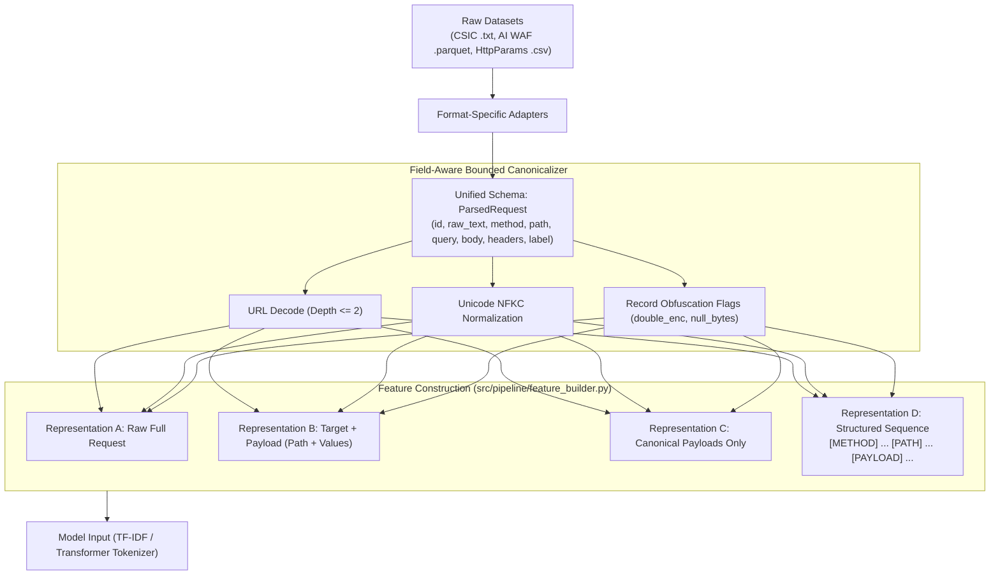
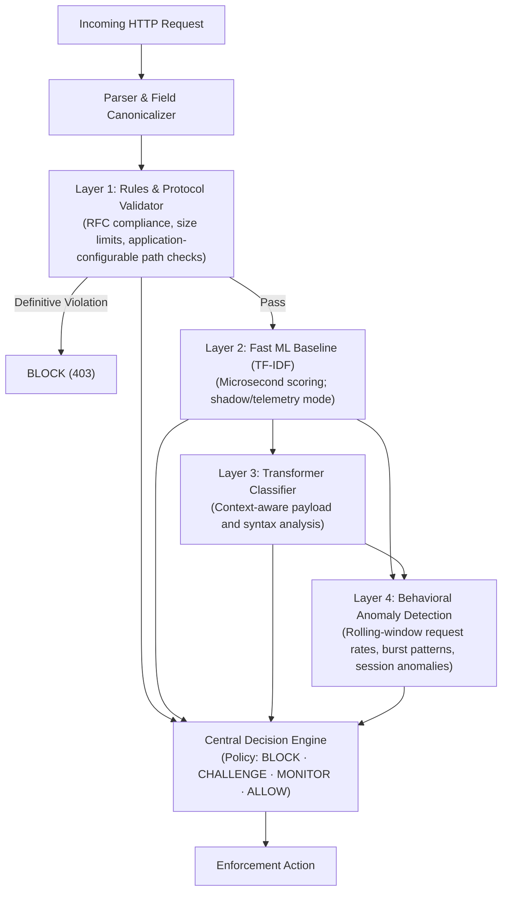

# Transformer-Based WAF: Master Architecture & Implementation Plan

**Target Deployment:** Local Laptop (NVIDIA RTX 2050 4 GB / CPU)  
**Training Compute:** Local Laptop GPU/CPU or AWS Cloud Node (NVIDIA T4 on `g4dn.xlarge`)  
**Compute Budget Cap:** Maximum \$20 USD for total model training (Multi-layer operational & cloud-side time caps enforced)  
**Status:** Architecture Refined & Fully Tightened (Independent Cloud-Side Timer Added)  

---

## 1. Executive Summary & Root Problem

### The Core Failure (Why Previous Models Failed Across Datasets)
In baseline experiments, a character TF-IDF + Logistic Regression model trained on the **AI WAF** dataset reached **99.41% accuracy** and a **0.40% False Positive Rate (FPR)** on in-domain validation. However, when evaluated on **CSIC 2010**:
- The **False Positive Rate reached 95.95%** (falsely flagging 34,542 out of 36,000 normal Spanish web requests as malicious).
- Stripping the `Host:` header did not resolve the issue (**99.88% FPR**).
- Using only the URL path (`request_target`) kept the FPR unacceptably high at **66.31%**.

### Why This Happened
1. **Domain & Lexical Shift**: The baseline model memorized words and headers common to modern English blog/news sites in AI WAF (e.g., `Chrome 114`, `Windows`, `techpulse`). When exposed to 2010 Spanish e-commerce parameters (`id_articulo`, `cant`, `/tienda1/`) and older browser user agents (`Konqueror`), the linear model assigned high positive weights to these unfamiliar patterns, classifying legitimate requests as attacks.
2. **Whole-Request Flaw**: The model treated the entire HTTP request as one flat character string, failing to separate application-specific context (hosts, routing paths) from attack payloads (SQL injections, XSS syntax).
3. **CSIC Splitting Artifacts**: In the raw CSIC dataset, normal traffic was recorded in separate files from anomalous traffic. A flat text model easily latches onto tool/script headers rather than true injection semantics.

---

## 2. Scientific Benchmark Integrity: Prior Exposure & Partitioning

> [!CRITICAL]
> **Honest Scientific Disclosure Regarding CSIC Test Data**:
> Earlier exploratory experiments already evaluated models on the entire official CSIC test set, and those findings directly informed this project's design. Consequently, reserving half of those same requests cannot be claimed as a completely untouched, blind benchmark.
> 
> To maintain strict academic and scientific honesty, we adopt the following two-tier evaluation framework:

### A. Two-Tier Evaluation Framework

| Tier | Evaluation Partition | Scientific Description | Purpose |
| :--- | :--- | :--- | :--- |
| **Tier 1 (Current Scope)** | **Post-Hoc Held-Out CSIC Partition (50%)** | Disjoint test subset carved from CSIC test data; **prior exposure explicitly disclosed**. | Measures comparative improvement across representations on CSIC without tuning on these specific rows. |
| **Tier 2 (Gold-Standard Research)** | **Independent Unseen Dataset** | A completely separate, external labeled full-request dataset with **zero prior exposure**. | Validates genuine out-of-domain generalization without any retrospective bias. |

### B. Partition Definitions for CSIC Experiments

| Partition Name | Source Composition | Label Distribution | Defined Purpose | Access Policy |
| :--- | :--- | :--- | :--- | :--- |
| **CSIC Development Partition (50%)** | 18,000 normal + 12,532 anomalous | Labeled Benign & Malicious | Error analysis, Phase 2 representation tests, primary threshold calibration | Open during development |
| **Post-Hoc Held-Out CSIC Partition (50%)** | 18,000 normal + 12,533 anomalous | Labeled Benign & Malicious | Post-hoc held-out comparative evaluation | **Sealed** until Phase 2 & 3 final evaluations |
| **CSIC Normal Training Pool** | 36,000 from `normalTrafficTraining` | 100% Benign | False-positive diagnostics & carefully controlled benign-context templates | Available for training/dev |

### C. Refined Template Auditing & Strict Group Assignment
1. **Indivisible Group Assignment**: Each template group (`path + tuple(sorted(param_keys))`) must be assigned **wholly and indivisibly** to exactly one partition (either Development or Held-Out, never split across both).
2. **Mandatory Conflict Investigation**: If any group contains conflicting labels (e.g., identical path and parameter keys labeled benign in one request and malicious in another), it must be **flagged and investigated**, rather than silently resolved or dropped.
3. **Payload Similarity Audit**: Separately audit normalized query values and body payloads across partitions to detect repeated attack vectors (e.g., standard SQLi union payloads) appearing across different endpoints.
4. **Boundary Leakage Reporting**: Explicitly calculate and report cross-boundary group leakage counts *before* vs. *after* grouping.
5. **Acknowledge Remaining Limitations**: Path-and-parameter grouping significantly mitigates structural leakage, but it cannot guarantee that semantically similar attack payloads will not cross partitions. This remaining limitation will be explicitly documented in all evaluation reports.

---

## 3. Core Technical Safeguards in the Master Plan

| Item | Required Safeguard | Implementation in Master Plan |
| :--- | :--- | :--- |
| **1. Honest Exposure Disclosure** | CSIC test files were previously inspected. | Explicitly report CSIC results as a **Post-Hoc Held-Out Partition**, disclosing prior exposure. |
| **2. Indivisible Template Grouping** | Row-level splits leak template structures. | Assign groups wholly to one partition, investigate label conflicts, and audit payload similarity across endpoints. |
| **3. Complete Pipeline Freezing** | Freezing the threshold alone is insufficient. | Freeze the **entire pipeline** (preprocessing, canonicalization rules, feature representation, model weights, decision threshold, and firewall policy) before evaluating held-out data. |
| **4. Balanced Dev Calibration** | `normalTrafficTraining.txt` has no attacks. | Calibrate decision thresholds on the labeled **CSIC Development Partition** (containing both classes), freeze them, and evaluate on held-out data. |
| **5. Independent Cloud-Side Timeouts** | In-script shutdown fails if the script crashes; CPU-idle alarms are unreliable during GPU jobs. | Use an **independent, cloud-side time-based shutdown mechanism** (e.g., AWS EventBridge scheduled rule or SSM automation) as the primary hard 4-hour limit. Verify permissions before training. |
| **6. Multi-Layer Cost Safeguards** | The \$20 budget cap requires operational enforcement. | Combine cloud-side timer, OS boot watchdog (`shutdown -h +240`), supplementary idle alarms, and prompt post-training termination of provisioned EBS volumes. |
| **7. Realistic Research Targets** | Metrics are hypotheses, not guarantees. | Treat the $<3\%$ FPR and $\ge 90\%$ recall targets as research goals. Report measured results honestly even if they fall short. |
| **8. Shadow Mode Before Production Claims** | Benchmark scores do not prove production readiness. | Run models in shadow mode, benchmark on replayed historical traffic, and evaluate false positives on legitimate production requests before enabling automatic blocking. |

*Note on Tokenization:* `distilbert-base-uncased` lowercases inputs during tokenization. Preserving original case in `ParsedRequest` remains vital for rules, audit logs, and forensics, but the uncased tokenizer behavior is recorded as a known constraint for Transformer inputs.

---

## 4. End-to-End System Architecture

### A. Data Preprocessing & Feature Pipeline



### B. Runtime 4-Layer Firewall Architecture



---

## 5. Phase-by-Phase Roadmap

### Phase 1: Data Pipeline & Error Diagnosis
*Goal: Establish trustworthy data parsing, perform multi-level template auditing, and discover the exact n-grams driving the baseline false positives.*

- [x] **1.1 Standardized Schema (`src/pipeline/schema.py`)**:
  - Implements `ParsedRequest` dataclass with raw text, decomposed components, canonical payloads, and encoding flags.
- [x] **1.2 Bounded Field Canonicalizer (`src/pipeline/canonicalizer.py`)**:
  - Bounded URL decode (depth $\le 2$).
  - Absolute URI handling (`urlsplit` extraction).
  - Obfuscation flag tracking (`has_double_encoding`, `has_null_bytes`, etc.).
- [x] **1.3 HTTP Parser & Adapters (`src/pipeline/parser.py`)**:
  - RFC-compliant request line, header, query string, and body parser (`json` and `x-www-form-urlencoded`).
- [ ] **1.4 Refined Template Auditing & Partitioning**:
  - Group CSIC requests by normalized path and sorted parameter keys.
  - Assign each template group wholly and indivisibly to one partition.
  - Audit normalized query values and payload content similarity across groups.
  - Flag and investigate any label conflicts within groups.
  - Calculate and report boundary leakage counts before and after grouping, documenting remaining limitations.
- [ ] **1.5 Error Analysis Tool (`src/evaluation/error_analysis.py`)**:
  - Evaluates the baseline on the **CSIC Development Partition**.
  - Extracts the top false-positive requests and computes the exact contribution scores ($w_i \cdot x_i$) to identify the specific character n-grams driving false alarms.
  - Groups errors by path, parameter names, headers, and encoding patterns.
  - Outputs `reports/false_positive_error_analysis.json`.

---

### Phase 2: Representation Experiments & Baseline Repair
*Goal: Answer the core question: Does separating payload semantics from application-specific context improve cross-dataset detection without sacrificing attack recall?*

- [ ] **2.1 Feature Builder (`src/pipeline/feature_builder.py`)**:
  Generates four test representations from `ParsedRequest`:
  - **Rep A (Full Raw Request)**: Current baseline.
  - **Rep B (Target + Payload)**: Strips static headers, keeps path and parameters.
  - **Rep C (Canonical Payloads Only)**: Inspects only parameter/body values.
  - **Rep D (Structured Serialization)**:
    `[METHOD] GET [PATH] /tienda1/index.jsp [PARAM] modo = 2 [PAYLOAD] ' OR 1=1 --`
- [ ] **2.2 Baseline Representation Benchmark (`src/evaluation/cross_dataset.py`)**:
  - Train TF-IDF on AI WAF for each representation.
  - Evaluate on the **CSIC Development Partition** (protecting the held-out partition).
  - Track False Positive Rate and Malicious Recall together.
  - **Decision Gate**: If a representation significantly reduces false positives while preserving recall, proceed to Phase 3. If not, inspect parsing differences, normalization artifacts, and label quality before spending compute.

---

### Phase 3: Transformer Model Training & Benchmark
*Goal: Fine-tune a lightweight Transformer to learn syntax semantics (SQL, XSS, Path Traversal) rather than surface-level vocabulary.*

- [ ] **3.1 Model Candidates**:
  - **Candidate 1**: `distilbert-base-uncased` (66M parameters). Note: tokenization is uncased.
  - **Candidate 2**: `all-MiniLM-L6-v2` (22M parameters). Benchmark empirically against DistilBERT.
  - Register special structural tokens (`[METHOD]`, `[PATH]`, `[PARAM]`, `[PAYLOAD]`, `[HEADERS]`) and resize embeddings.
- [ ] **3.2 Hard-Capped Cloud Training & Independent Shutdown Safeguards**:
  - Check actual AWS regional pricing for compute (`g4dn.xlarge`), EBS storage, and data transfer.
  - Execute a **1-epoch sanity check** on a small sample to measure memory, step time, and projected cost.
  - **Multi-Layer Out-of-Band Shutdown Infrastructure**:
    1. **Primary**: Independent, time-based **cloud-side timer** (AWS EventBridge schedule or Systems Manager automation) that stops/terminates the instance after a strict 4-hour window from launch. Verify permissions before training.
    2. **Secondary Local**: OS-level hard watchdog (`shutdown -h +240` at boot) to halt the OS locally if cloud API calls delay.
    3. **Supplementary**: CloudWatch alarm (`CPUUtilization < 5%` for 15 mins) as an auxiliary check, acknowledging that GPU-bound workloads may idle CPU or crashed loops may pin CPU.
  - **EBS Storage Termination**: Promptly terminate attached EBS storage volumes upon experiment conclusion to avoid persistent storage fees, strictly maintaining total spend below the **\$20 cap**.
  - Set `max_length = 128` (track and report truncation rate for long requests), `batch_size = 4`, `gradient_accumulation_steps = 4`.
- [ ] **3.3 Pipeline Freeze & Final Evaluation**:
  - Freeze the **entire pipeline** (preprocessing, representation, model weights, threshold, policy).
  - Evaluate on the **Post-Hoc Held-Out CSIC Partition** and report actual recall achieved at the frozen threshold.
  - Report: Precision, Recall, FPR, F1, PR-AUC, and Confusion Matrix.
- [ ] **3.4 End-to-End Latency Measurement**:
  - Measure full latency (parsing + canonicalization + feature building + inference) at p50 and p95 on both CPU and RTX 2050.

---

### Phase 4: Live 4-Layer Firewall & Decision Engine
*Goal: Combine rule-based fast blocking, ML contextual scoring, and behavioral tracking into a production-grade firewall.*

- [ ] **4.1 Layer 1: Rules & Protocol Validator (`src/firewall/rules_engine.py`)**:
  - RFC protocol validation (illegal HTTP verbs, oversized headers, malformed encoding).
  - Application-configurable path traversal checks (evaluating normalized paths against configured security boundaries).
- [ ] **4.2 Layer 2 & 3: Model Scoring Middleware (`src/firewall/ml_detector.py`)**:
  - Layer 2 (TF-IDF): Fast scoring in shadow mode.
  - Layer 3 (Transformer): Contextual analysis for ambiguous or high-risk requests.
- [ ] **4.3 Layer 4: Behavioral Anomaly Detector (`src/firewall/anomaly_detector.py`)**:
  - Sliding time-window tracking per client IP/session (request frequency, error bursts, scanning patterns).
- [ ] **4.4 Central Decision Engine (`src/firewall/decision_engine.py`)**:
  - Configurable enforcement policy:
    - **BLOCK (403)**: Layer 1 rule violation OR Layer 3 risk score $> \tau_{\text{block}}$.
    - **CHALLENGE (Captcha/Rate-Limit)**: Layer 4 behavioral anomaly triggered.
    - **MONITOR (Log only)**: Moderate risk score ($\tau_{\text{monitor}} \le \text{score} < \tau_{\text{block}}$).
    - **ALLOW**: All checks pass.
- [ ] **4.5 Shadow Mode & Replay Validation**:
  - Test the entire pipeline on replayed historical traffic and a controlled canary deployment to verify zero disruption before enabling enforcement.

---

## 6. Performance Targets as Empirical Hypotheses

| Metric | Target Hypothesis to Validate | Measurement Strategy |
| :--- | :--- | :--- |
| **In-Domain Validation** | F1 $> 0.98$, FPR $< 0.5\%$ | AI WAF held-out validation set |
| **Cross-Dataset Generalization** | Recall $\ge 90\%$, FPR $< 3.0\%$ | Measured on Post-Hoc Held-Out CSIC Partition at frozen threshold |
| **End-to-End Transformer Latency** | $< 15\text{ ms}$ (RTX 2050) / $< 35\text{ ms}$ (CPU) | Measured p50 & p95 including parsing + inference |
| **Rules + TF-IDF Latency** | $< 2\text{ ms}$ | Measured on single-core CPU |
| **Training Cost** | $\le \$5.00$ (Hard Budget Cap: \$20) | Cloud-side timer, OS watchdog & prompt EBS termination |

---

## 7. Current Project State (Standby Mode)

```
transformer-waf/
├── data/
│   ├── raw/ (ai_waf, csic2010, http_params)
│   └── processed/ (waf_requests.csv)
├── reports/ (baseline_metrics.json, request_representation_diagnostic.json)
├── src/
│   ├── pipeline/
│   │   ├── __init__.py
│   │   ├── schema.py               [COMPLETED]
│   │   ├── canonicalizer.py        [COMPLETED]
│   │   ├── parser.py               [COMPLETED]
│   │   ├── validate_pipeline.py    [COMPLETED]
│   │   └── feature_builder.py      [PHASE 2 - ON HOLD]
│   ├── evaluation/
│   │   ├── error_analysis.py       [PHASE 1 - ON HOLD]
│   │   └── cross_dataset.py        [PHASE 2 - ON HOLD]
│   ├── models/
│   │   └── transformer_waf.py      [PHASE 3 - ON HOLD]
│   └── firewall/
│       ├── rules_engine.py         [PHASE 4 - ON HOLD]
│       ├── anomaly_detector.py     [PHASE 4 - ON HOLD]
│       └── decision_engine.py      [PHASE 4 - ON HOLD]
```
