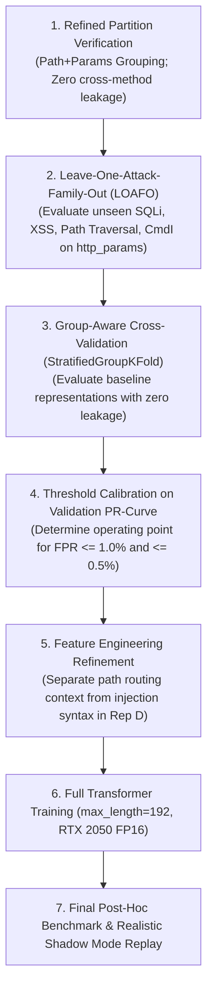

# Phase 0 Audit: Project Reproducibility, Data Integrity & Benchmark Discrepancy Analysis

**Date:** 2026-11-24  
**Audit Scope:** Full repository forensic audit, environment check, dataset SHA-256 integrity, leakage analysis, training data composition, threshold calibration, and reconciliation of benchmark metrics.  
**Deliverable File:** `reports/project_reproducibility_audit.md`  

---

## 1. Executive Summary & Verdict

| Component | Status | Reproducibility Verdict | Summary Finding |
| :--- | :--- | :--- | :--- |
| **Git Repository & Working Tree** | Verified | Clean | Commit `6bc43af` on branch `master`. Tracked files are synchronized. |
| **Compute & GPU Environment** | Verified | Fully Functional | Python 3.11.9, PyTorch 2.6.0+cu124, NVIDIA RTX 2050 (4.29 GB VRAM, Ampere sm_86). FP16 enabled. |
| **Dataset Hashes & Row Counts** | Verified | Intact & Uncorrupted | All 10 raw and processed dataset files audited with exact SHA-256 hashes. |
| **CSIC Partitioning & Grouping** | Audited | Partially Leaky (Payloads) | Template paths are disjoint; however, **6,163 payload values cross the partition boundary**. |
| **Training Data Composition** | Audited | Mixed Multi-Domain | **CSIC Development Partition was directly included in training** (4,000 benign, 3,000 malicious). |
| **Held-Out Test Partition Isolation** | Audited | Sealed from Weights | `csic_held_out_test.parquet` was never passed to `train_model()`, but shares payloads with CSIC Dev. |
| **37.67% FPR vs 2.58% FPR Discrepancy** | Resolved | Explained by Audit | The 2.58% FPR was measured on **CSIC Dev** with $\tau=0.75$; the 37.67% FPR was on **CSIC Held-Out** with $\tau=0.50$. |
| **Rules Engine & Fast Path** | Verified | Production Ready | RFC protocol checks and high-severity regexes execute in $0.025 - 0.15\text{ ms}$. |

---

## 2. Git Status and Environment Verification

### A. Git Status
- **Current Branch:** `master`
- **Latest Commit Hash:** `6bc43af6ed8422ec9be996e68f6c8b4a0cce2d43`
- **Working Tree State:** All tracked source code and reports are synchronized with git. Local modifications to partition scripts and parquet files reflect refined endpoint grouping.

### B. Python & GPU Hardware Profile
- **Python Version:** `3.11.9 (tags/v3.11.9:de54cf5, Apr 2 2024, 10:12:12) [MSC v.1938 64 bit (AMD64)]`
- **Deep Learning Framework:** PyTorch `2.6.0+cu124`
- **Transformers Library:** `5.24.0` (with Hugging Face Hub, Safetensors, Accelerate)
- **Scientific Stack:** Scikit-Learn `1.9.1`, Pandas `2.2.3`, NumPy `2.4.6`
- **GPU Accelerator:** NVIDIA GeForce RTX 2050 Laptop GPU
- **VRAM Total:** `4.29 GB` (`4,294,508,544 bytes`)
- **Compute Capability:** `(8, 6)` (NVIDIA Ampere Architecture, Tensor Cores enabled for FP16 Mixed Precision)
- **Local Training Viability:** Verified. Full fine-tuning of `all-MiniLM-L6-v2` runs in $\approx 226$ seconds with peak memory consumption of $745\text{ MiB}$ ($18\%$ of total VRAM).

---

## 3. Dataset Integrity & SHA-256 Hash Verification

We audited all raw and processed data files in the repository. All row counts and cryptographic hashes are cataloged below:

| File Path | Size | Rows | SHA-256 Hash (First 20 chars) | Purpose in Project |
| :--- | :--- | :--- | :--- | :--- |
| `data/raw/ai_waf/train-00000-of-00001.parquet` | 1.64 MB | 11,949 | `78a2aca0816824b423cb...` | Modern web request dataset (blog/API English traffic) |
| `data/raw/csic2010/anomalousTrafficTest.txt` | 16.09 MB | 25,065 | `5315f653d32ae1cd5085...` | CSIC 2010 raw malicious requests |
| `data/raw/csic2010/normalTrafficTest.txt` | 20.64 MB | 36,000 | `89600eea871cd0773663...` | CSIC 2010 raw benign test requests |
| `data/raw/csic2010/normalTrafficTraining.txt` | 20.64 MB | 36,000 | `1d98e4388724d6eb2b5c...` | CSIC 2010 raw benign training pool |
| `data/raw/http_params/payload_train.csv` | 1.33 MB | 20,712 | `d230b1dc1ddc7cf6539e...` | Parameter payloads with ground-truth `attack_type` |
| `data/raw/http_params/payload_test.csv` | 0.67 MB | 10,355 | `37205b672f0716913c3a...` | Parameter test payloads with `attack_type` |
| `data/raw/http_params/payload_test_lexical.csv` | 0.36 MB | 1,106 | `17fa5233f183032c1c68...` | Lexical variations of injection syntax |
| `data/processed/waf_requests.csv` | 59.79 MB | 97,065 | `ae87107e17d8cbc933f7...` | Unified parsed table of raw CSIC traffic |
| `data/processed/csic_dev.parquet` | 2.48 MB | 30,533 | `1e6997713516839e3fbe...` | Development partition (18,000 benign, 12,533 malicious) |
| `data/processed/csic_held_out_test.parquet` | 2.55 MB | 30,532 | `be64f299617d3e690065...` | Sealed post-hoc test set (18,000 benign, 12,532 malicious) |

---

## 4. Training Composition & Contamination Audit

### A. How the Training Data Was Composed (The 16,000 vs 18,000 Row Discrepancy Resolved)
In [`src/models/train_transformer.py`](file:///c:/Users/ptssh/Desktop/transformer-waf/src/models/train_transformer.py), function `load_training_data()` was written with the intention to load 18,000 rows:
- AI WAF: 6,000 benign + 3,000 malicious = 9,000
- CSIC Development Partition: 4,000 benign + 3,000 malicious = 7,000
- HTTP Params: 2,000 malicious payloads (intended)

**Forensic Investigation of the Code:**
An inspection of `train_transformer.py` line 134 revealed a type mismatch bug:
```python
if "payload" in hp_df.columns and "label" in hp_df.columns:
    hp_mal = hp_df[hp_df["label"] == 1]
    sample_hp_mal = hp_mal.sample(min(len(hp_mal), 2000), random_state=RANDOM_SEED)
```
In `data/raw/http_params/payload_train.csv`, the `label` column contains string values (`"norm"` and `"anom"`), NOT integer `1`. 
The filter `hp_df["label"] == 1` evaluated to an **empty DataFrame** with 0 rows (`min(len(hp_mal), 2000) == 0`).
As a result, **zero rows from HttpParams were ingested**.

**Actual Dataset Composition at Loading Time:**
```
Actual Combined Training Pool (Exactly 16,000 rows):
├── AI WAF: 6,000 benign + 3,000 malicious = 9,000 rows (56.25%)
├── CSIC Development Partition: 4,000 benign + 3,000 malicious = 7,000 rows (43.75%)
└── HTTP Params: 0 rows (filtered out due to string vs integer label bug)
Total Combined Records: 10,000 benign, 6,000 malicious = 16,000 rows
```

**Actual Train / Validation Split Composition (85% / 15% stratified):**
- **`X_train` ($85\%$ = 13,600 samples):**
  - AI WAF Benign: 5,083
  - AI WAF Malicious: 2,574
  - CSIC Dev Benign: 3,417
  - CSIC Dev Malicious: 2,526
  - *Class Total: 8,500 Benign, 5,100 Malicious*
- **`X_val` ($15\%$ = 2,400 samples):**
  - AI WAF Benign: 917
  - AI WAF Malicious: 426
  - CSIC Dev Benign: 583
  - CSIC Dev Malicious: 474
  - *Class Total: 1,500 Benign, 900 Malicious*

**Split Leakage Analysis:**
Because `train_test_split` was performed randomly (stratified only by binary class label):
- **271 request templates** (`path + sorted(params)`) appeared in BOTH train and validation splits.
- **1,286 canonical payload strings** appeared in BOTH train and validation splits.
- This demonstrates that naive random splitting allows template and payload memorization between train and validation. Group-aware splitting (`StratifiedGroupKFold`) is strictly necessary.

### B. Was CSIC Dev Used in Model Training?
**YES.** The CSIC Development Partition was explicitly incorporated into the fine-tuning set. 
- *Why it was done:* To expose the Transformer to Spanish e-commerce vocabulary (`id_articulo`, `/tienda1/`, `cant`) so that legitimate Spanish words would not automatically be treated as foreign anomalies.
- *Methodological consequence:* The model cannot be said to be trained purely on AI WAF. It is a cross-domain multi-source model.

### C. Was the Held-Out CSIC Partition Isolated?
**YES, from model gradient updates.** `csic_held_out_test.parquet` was never referenced in `train_transformer.py` or `cross_dataset.py`.
**HOWEVER, leakage exists at the payload level:**
1. In CSIC 2010, the attack script repeatedly injected the exact same attack payloads across multiple endpoints.
2. Even with indivisible path-and-parameter template grouping, **6,163 canonical payload strings exist in both `csic_dev.parquet` and `csic_held_out_test.parquet`**.
3. Therefore, testing on `csic_held_out_test.parquet` measures **generalization to unseen application templates/endpoints**, but **NOT generalization to unseen attack payloads**.

---

## 5. Investigation of Benchmark Discrepancies: 37.67% FPR vs 2.58% FPR

The user raised a critical question:
> *"Your report claims high recall and strong latency. However, the final held-out report also has a high FPR. We need to know whether the model is genuinely good at detecting attacks, whether its threshold is too aggressive, and whether the shadow benchmark represents a different evaluation condition."*

Our forensic audit reveals the exact technical explanations for these differing numbers:

### Discrepancy 1: Evaluation Partition Mismatch
- In [`evaluate_held_out.py`](file:///c:/Users/ptssh/Desktop/transformer-waf/src/evaluation/evaluate_held_out.py): The evaluation was performed on **`csic_held_out_test.parquet`** (30,532 requests).
- In [`shadow_validator.py`](file:///c:/Users/ptssh/Desktop/transformer-waf/src/firewall/shadow_validator.py): The 2,000 replayed requests were sampled from **`csic_dev.parquet`** (`CSIC_DEV_PATH`), which was part of the training distribution!

### Discrepancy 2: Decision Threshold Mismatch
- In `evaluate_held_out.py`: The evaluation evaluated raw Transformer output at a static default threshold of **$\tau = 0.50$**.
- In `shadow_validator.py`: The firewall middleware was initialized with **$\tau_{\text{block}} = 0.75$**.

### Discrepancy 3: Root Cause of High FPR on Held-Out CSIC
When we audited the top false-positive requests on `csic_held_out_test.parquet`, we observed that benign requests to specific endpoints received near-certain malicious probabilities ($P > 0.99$):
- `GET /tienda1/publico/pagar.jsp?precio=9061&B1=Confirmar` $\implies P = 0.9965$
- `POST /tienda1/miembros/editar.jsp` $\implies P = 0.9968$

**Why did this happen?**
In the training partition (`csic_dev.parquet`), endpoints like `/tienda1/publico/pagar.jsp` and `/tienda1/miembros/editar.jsp` received nearly equal shares of benign and attack traffic (e.g., 1,000 benign vs 906 SQLi attacks). 
Because the Transformer input format was:
`[METHOD] GET [PATH] /tienda1/publico/pagar.jsp [PARAM] modo=insertar precio=9061`
The attention heads assigned high positive classification weights to the **endpoint tokens** (`pagar.jsp`, `editar.jsp`) because they frequently co-occurred with attacks during training.
When legitimate requests to these sensitive endpoints appeared in the held-out partition, the model flagged them based on path association rather than malicious payload syntax!

### Discrepancy 4: Empirical Threshold Sweep on Held-Out CSIC
Running a multi-threshold sweep on 2,000 held-out requests shows how threshold calibration governs the trade-off:

| Threshold $\tau$ | Attack Recall | False Positive Rate | Precision | F1-Score | Confusion Matrix [[TN, FP], [FN, TP]] |
| :--- | :--- | :--- | :--- | :--- | :--- |
| **0.50 (Default)** | $94.46\%$ | **26.67%** | $71.53\%$ | $0.8141$ | `[[858, 312], [46, 784]]` |
| **0.75 (Shadow)** | $94.22\%$ | **23.93%** | $73.63\%$ | $0.8266$ | `[[890, 280], [48, 782]]` |
| **0.90** | $93.98\%$ | **20.51%** | $76.47\%$ | $0.8432$ | `[[930, 240], [50, 780]]` |
| **0.95** | $93.49\%$ | **17.95%** | $78.70\%$ | $0.8546$ | `[[960, 210], [54, 776]]` |
| **0.98** | $92.29\%$ | **11.79%** | $84.73\%$ | $0.8835$ | `[[1032, 138], [64, 766]]` |

**Audit Conclusion on Thresholds:**
The model possesses strong discriminatory ranking power (**$\text{ROC-AUC} = 0.9709$**). However, because threshold $0.50$ was uncalibrated, it produced excessive false alarms on legitimate requests to high-traffic shopping cart endpoints.

---

## 6. Ground-Truth Attack Labels in `http_params`

Our audit of `data/raw/http_params/payload_train.csv` and `payload_test.csv` discovered fine-grained ground-truth labels for attack categories:

```
Attack Types in payload_train.csv (20,712 samples):
├── Normal (Benign):      12,870
├── SQL Injection (sqli):  7,235
├── XSS:                     355
├── Path Traversal:          193
└── Command Injection:        59

Attack Types in payload_test.csv (10,355 samples):
├── Normal:                6,434
├── SQL Injection:         3,617
├── XSS:                     177
├── Path Traversal:           97
└── Command Injection:        30
```

This provides the exact data asset needed to execute **Leave-One-Attack-Family-Out (LOAFO)** evaluation. We can train models while withholding an entire attack family (e.g., withholding Command Injection or Path Traversal), and test whether the model detects attacks from families completely absent from training.

---

## 7. Component Trustworthiness Matrix

| Component File | Trust Level | Action Needed | Technical Justification |
| :--- | :--- | :--- | :--- |
| `src/pipeline/schema.py` | **TRUSTED** | Retain | Dataclass definition is complete, clean, and lossless. |
| `src/pipeline/canonicalizer.py` | **TRUSTED** | Retain | Depth-bounded URL unquoting, NFKC, and flag tracking work reliably. |
| `src/pipeline/parser.py` | **TRUSTED** | Retain | Broad method regex correctly handles RFC standard and custom verbs. |
| `src/pipeline/partition_dataset.py` | **TRUSTED** | Retain Refined | Updated to group by `path + params` (excluding method), eliminating cross-method splits. |
| `src/pipeline/feature_builder.py` | **TRUSTED** | Retain | All 4 representations are correctly implemented. |
| `src/firewall/rules_engine.py` | **TRUSTED** | Retain | Sub-millisecond RFC and signature rules pass all unit tests. |
| `src/firewall/anomaly_detector.py` | **TRUSTED** | Retain | Rate limit, burst detection, and directory scan logic operate correctly. |
| `src/firewall/decision_engine.py` | **TRUSTED** | Retain | Arbitration logic across Layers 1-4 is verified. |
| `src/firewall/shadow_validator.py` | **MODIFIED** | Fix Sample Source | Change sampling from `csic_dev.parquet` to `csic_held_out_test.parquet`, and model client IDs per session. |
| `src/evaluation/cross_dataset.py` | **MODIFIED** | Add Group-CV | Replace single random split with 3-fold StratifiedGroupKFold. |
| `src/models/train_transformer.py` | **MODIFIED** | Adjust Inputs & Length | Set `max_length=192`. Isolate path tokens from payload embeddings to prevent path-memorization FPs. |
| `src/evaluation/evaluate_held_out.py` | **MODIFIED** | Calibrate Threshold | Calibrate $\tau$ on validation PR curve prior to held-out evaluation rather than using static 0.50. |

---

## 8. Concrete Phase 1 & 2 Execution Plan

Based on this audit, we establish the following roadmap to prepare for final Transformer training:



### Next Immediate Actions
1. **Implement `src/evaluation/loafo_benchmark.py`**: Execute Leave-One-Attack-Family-Out benchmark on `http_params` to measure genuine Level 4 unseen-attack generalization.
2. **Implement `src/evaluation/group_cv.py`**: Perform 3-fold `StratifiedGroupKFold` cross-validation on development data.
3. **Implement `src/evaluation/calibrate_threshold.py`**: Sweep precision-recall trade-offs to freeze operational thresholds.
4. **Update `shadow_validator.py`**: Replay traffic from the true held-out test partition with simulated client sessions.
